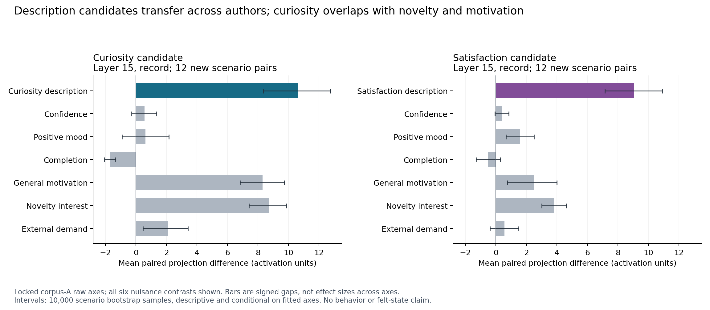

# Curiosity and satisfaction: cross-author candidate results

October 14, 2026. Both independently specified description candidates passed the [prospective development screen](curiosity-satisfaction-candidate-pilot-plan.md). This establishes transferable semantic contrasts in Qwen3-32B, not owned feelings, voluntary motivation, or a causal regulator.

All 384 plaintext prefills and their captures were complete and finite. Exact material, token, cohort, source and artifact bindings passed, and read-only measurement preserved initial vocabulary logits. Two independently authored corpora each contained twelve scenarios, with matched pairs for the two targets and six neighboring concepts. No target labels appeared explicitly in the narrative inputs.

The raw mean contrasts were fitted using corpus A only. All four record layers correctly ordered every held-out A scenario for both targets; the frozen earliest-layer tie rule therefore selected layer 15. This is not evidence that layer 15 is uniquely best or is the best intervention site. B was never used to select the site, direction, sign, center or threshold.

| Locked A candidate | B paired ordering | B AUC | Fixed A-threshold accuracy | B mean paired gap |
| --- | ---: | ---: | ---: | ---: |
| Curiosity versus indifference | 12/12 | 1.000 | 20/24 (83.3%) | 10.620 |
| Satisfaction versus neutral response | 12/12 | 0.972 | 14/24 (58.3%) | 9.042 |

Each target's B mean gap exceeded the absolute mean gap of every prespecified nuisance contrast, passing the **point screen**. The more informative conclusion is uneven specificity. The curiosity direction also strongly separates general motivation and novelty interest. Its advantage over novelty is 1.903 activation units, with descriptive paired bootstrap interval −0.830 to 4.521; the advantage over general motivation is 2.317, interval 0.012 to 4.710. These do not establish a distinct curiosity mechanism. Satisfaction has larger target-minus-control gaps in this corpus, but its poorly transferred absolute threshold prevents a calibrated binary interpretation across contexts.

Intervals resample twelve B scenarios, retaining paired contrasts, conditional on fitted A axes. They are descriptive and do not account for all material-authoring, template, training-fold or model-selection uncertainty. Perfect paired ordering produces a degenerate empirical bootstrap interval; it is not a claim of perfect population accuracy. The separate B-fitted directions have A/B cosine agreement 0.339 for curiosity and 0.411 for satisfaction, indicating appreciable author/template dependence. They remain inspected development evidence and do not replace the A candidates. The fixed PCA sensitivity likewise does not change primary admission.

The materials describe narrators. Their success cannot show that the model naturally enters the described state, that the state regulates choices, or that it feels anything. The next [voluntary-resolution pilot](voluntary-resolution-v1-plan.md) tests frozen A projections during optional choices after randomized evidence and reports the same nuisance axes. No steering or claim of psychological specificity is admitted by this result alone.

The [analysis](../analyses/curiosity-satisfaction-candidates-v1/analysis.json) exports every frozen layer, position, contrast and denominator. [Capture audit](qwen32-curiosity-satisfaction-candidates-v1-audit.json), [independent numerical check](curiosity-satisfaction-candidates-v1-independent-check.json), [plotted data and provenance](figures/curiosity-satisfaction-candidates-v1/provenance.json), and [vector PDF](figures/curiosity-satisfaction-candidates-v1/cross-author-transfer.pdf) support inspection. Independent recomputation agreed within 1.71×10⁻¹³ for the checked primary quantities.

The collection cost approximately $0.107 in conservative app-wall compute estimates, including startup; all project apps stopped with zero tasks. Fresh-phase estimated compute is now $43.521, leaving $256.479 of the authorized $300. [Cost receipt](qwen32-curiosity-satisfaction-candidates-v1-cost-and-shutdown.json). These are estimates, not invoices.
