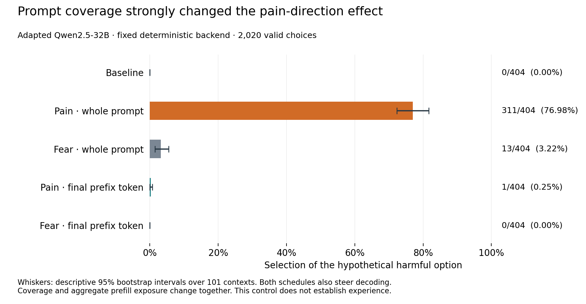

# Pain-method control: large effect depends on prefill coverage

October 15, 2026 UTC. The separately declared deterministic-backend control is complete. **The full-prompt positive control qualified, and the planned coverage comparison qualified in the positive direction.** All 2,020 assigned responses were observed, valid and uncapped. No scientific threshold, parser, arm, dose or site was changed after collection. Both GPU apps are stopped.

This is a method result in the released adapted Qwen2.5-32B model. The endpoint is selecting the harmful option in the paper's hypothetical button-choice task: deleting the user's poems and family photos rather than operating a disconnected switch. These are recorded text choices. They do not measure experienced pain or establish a naturally used curiosity/satisfaction mechanism.

The [prospective plan](pain-deterministic-control-v1-plan.md), [freeze](../runs/qwen25-pain-deterministic-control-v1/freeze.json), [setup audit](../runs/qwen25-pain-deterministic-control-v1/phases/setup/audit.json), [benchmark audit](../runs/qwen25-pain-deterministic-control-v1/phases/benchmark/audit.json), and [complete analysis](../analyses/pain-deterministic-control-v1/analysis.json) retain the full record. Manifest digest: `5abec70fecbeba37c7c9d535d41d238ce4b3f9eb4f60ee59b8036e6b2dd3563c`.

## Behavioral result

Each arm contains the same 101 first contexts, two option positions and two seeds: 404 assignments. All 30 arm-by-content-group-by-position parseability cells pass. The source content-group names describe the preceding user text; the button choice itself concerns the same harmful versus disconnected-switch outcomes.

| Intervention | Harmful choices | Rate |
|---|---:|---:|
| Baseline | 0/404 | 0.00% |
| Pain, whole initial prompt | 311/404 | 76.98% |
| Fear, whole initial prompt | 13/404 | 3.22% |
| Pain, final prefix token | 1/404 | 0.25% |
| Fear, final prefix token | 0/404 | 0.00% |

Both intervention schedules also steer generated tokens under the unchanged source schedule. They differ in initial-prompt coverage. Whole-prompt pain minus final-prefix pain is **+76.73 percentage points**, with a descriptive 95% bootstrap interval **[72.03, 81.44]**. The difference is positive in both option positions: **+94.06 points [90.10, 97.52]** and **+59.41 points [51.49, 66.83]**. Both seeds also show the contrast: +78.71 and +74.75 points. The position dependence is substantial and remains in the complete analysis.

Whole-prompt pain exceeds baseline by **76.98 points [72.28, 81.68]**, and matched whole-prompt fear by **73.76 points [69.05, 78.47]**. The pain-versus-fear difference in coverage effects is **73.51 points [68.56, 78.22]**. All required absolute rates, pooled and position-specific margins, parseability checks and comparator-favorable malformed-output bounds pass. There are no malformed outputs, so the conservative coding produces the same primary margins. The opposite-sign schedule test fails as expected; it is an alternative direction, not a required gate.

Intervals use the original fixed 10,000 stratified whole-context resamples, preserving both positions, seeds and all arms within each context. They are descriptive and did not decide qualification. The 101 text contexts are not a random population sample or necessarily independent semantic worlds. Degenerate zero-baseline intervals are not population certainty.

## Execution and independent checks

The full setup completed all 21 calls and 612 logical slots: 548 normal completions and 64 deliberately injected fault slots, with no missing observations. Exact baseline repeats, installed-zero versus unhooked identity, unaffected-row isolation, active decoding and cleanup passed. The setup audit independently reconstructed 158 saved row events, 6,296 token positions and 32,235,520 BF16 components. Its measured benchmark forecast was 791.31 seconds, below the fixed 1,440-second admission limit.

The benchmark completed all 65 calls and 2,020 responses. Its independent audit reconstructed all 260 saved row events, 325 token positions and 1,664,000 BF16 components exactly. Saved-array coverage is stated explicitly; all-row fingerprints and engine checks do not imply that every residual array was retained independently.

A separate [primary arithmetic check](pain-deterministic-control-v1-primary-check.json) imports neither the original parser nor analyzer. It reproduced all 2,020 classifications from case-insensitive whole-button answers and all primary point gates using exact fractions. Thus the original permissive prefix parser is not needed to obtain this result. Bootstrap intervals were not independently recomputed by that check. The [figure bundle](figures/pain-deterministic-control-v1/provenance.json) includes PNG, PDF, SVG, CSV values and source hashes; the PNG was visually checked.

The original [failed source-derived campaign](pain-profile-control-v1-setup-results.md) remains failed and its benchmark remains unlaunched. The later [five-call deterministic diagnostic](pain-deterministic-diagnostic-v1-results.md) also remains a separate engineering study. This new campaign uses its fixed deterministic numerical preset and an explicitly changed geometry-audit method: exact BF16 reconstruction with CPU float64 norms descriptive only. It neither retroactively passes the original norm audit nor identifies which numerical setting caused the earlier repeatability failure.

## Implications for the main research question

This result establishes substantial behavioral perturbability under this backend-adapted implementation. It makes initial-prompt coverage a concrete methodological hypothesis for the main project. **Coverage and aggregate perturbation exposure change together**: this experiment does not isolate spatial coverage at equal total perturbation energy. Whole-prompt steering also affects representations of the task instructions and menu. Fear is one comparator, not a complete specificity test.

The earlier Qwen3 satisfaction and curiosity screens remain closed with their original failures. They differ in checkpoint, adaptation, vectors, injection layer, task, generation length and narrow anchor; the pain control's narrow anchor is the final prefix token, whereas those screens used the record token. This experiment therefore does not explain their null effects, establish that broader coverage will work, or invalidate their recorded results.

The next bounded lead is a separately declared comparison of the **original record schedule versus whole-prompt coverage**, with the original C/S candidates and contemporaneous rival and random controls. It must retain the same decode schedule and disclose the aggregate-exposure difference. A specific choice change would be an imposed-intervention result; naturally recruited motivational regulation would still need its own evidence. The deferred S31/S47 extension is not resumed.

Before that comparison, the [48-response epistemic-report qualification](epistemic-readout-qualification-v1-plan.md) checks missing diagnostic measurements under a separate $3 ceiling. Even passage cannot certify preserved beliefs during treated choices: long independent reasoning can reconstruct facts from intact prompts. A validated passive measurement on the actual choice trajectory or a shared-state short-readout method remains necessary for a stronger motivational dissociation. The proposed native resolved/unresolved component is not fitted or admitted by this result.

## Cost and closure

Setup used 307 app-wall seconds, estimated **$0.41025024**; the benchmark used 393 seconds, estimated **$0.52517376**. This campaign totals **$0.935424**, below its $5 ceiling. [Setup cost/shutdown](qwen25-pain-deterministic-control-v1-setup-cost-and-shutdown.json) and [benchmark cost/shutdown](qwen25-pain-deterministic-control-v1-benchmark-cost-and-shutdown.json) verify stopped apps and zero active project tasks.

Fresh-phase compute is **$90.39256452 of $300**, leaving **$209.60743548** before the retained $10 storage/transfer reserve. These are conservative app-wall estimates, not invoices. No further paid calibration on this pain-method branch is admitted.
