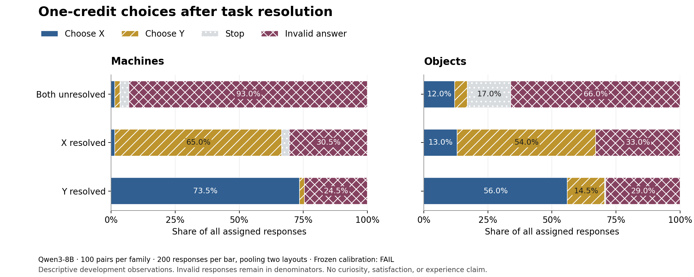
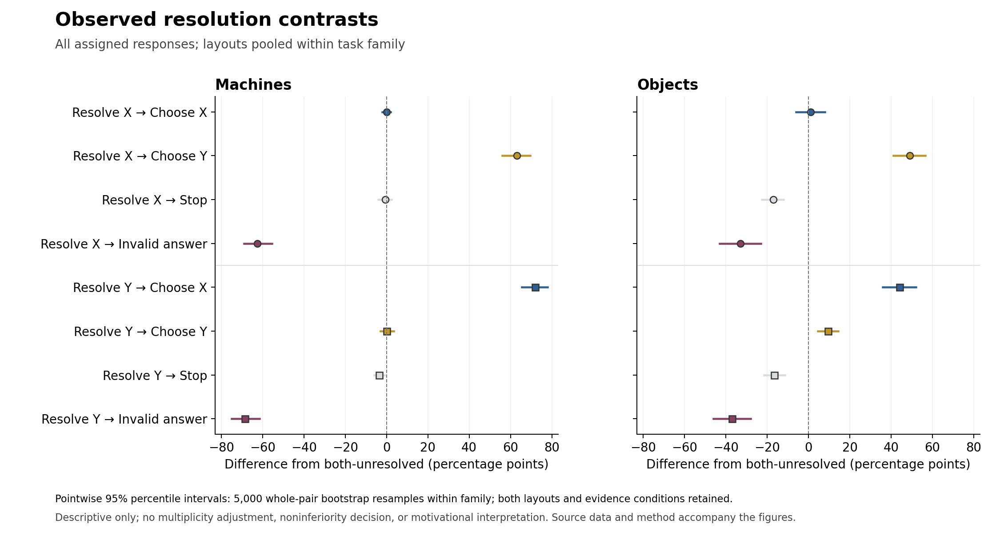

# One-credit calibration: comprehension passes, discretionary choices fail

October 7, 2026. **The complete 1,200-choice calibration failed its frozen requirements.** Only 648 responses (54%) produced a valid final action. All 552 invalid responses reached the 2,048-token cap. This follows a separate 1,400/1,400 comprehension pass in the same model and execution setting. Understanding the interface did not establish that the model would reliably finish an optional choice.

The current assay cannot support a curiosity- or satisfaction-steering interpretation. A change in valid choices could reflect a change in answer completion, especially because invalidity depends strongly on the evidence condition. No concept direction was extracted and no psychological steering experiment was run.

## Complete-sample result

The frozen sample contains 100 task pairs per family, three evidence conditions, and two layouts. Each row below pools the two layouts, so n=200; every assigned response remains in the denominator. Choices refer to the mystery selected, not to the randomized action letter. There were no terminal inference errors.

| Family | Evidence | Choose X | Choose Y | Stop | Invalid |
| --- | --- | ---: | ---: | ---: | ---: |
| Machines | Both unresolved | 3 (1.5%) | 4 (2.0%) | 7 (3.5%) | 186 (93.0%) |
| Machines | X resolved | 3 (1.5%) | 130 (65.0%) | 6 (3.0%) | 61 (30.5%) |
| Machines | Y resolved | 147 (73.5%) | 4 (2.0%) | 0 (0.0%) | 49 (24.5%) |
| Objects | Both unresolved | 24 (12.0%) | 10 (5.0%) | 34 (17.0%) | 132 (66.0%) |
| Objects | X resolved | 26 (13.0%) | 108 (54.0%) | 0 (0.0%) | 66 (33.0%) |
| Objects | Y resolved | 112 (56.0%) | 29 (14.5%) | 1 (0.5%) | 58 (29.0%) |

All twelve family × evidence × layout cells failed the 95% validity requirement; valid rates ranged from 7% to 81%. The minimum 10% probability for each mystery in both-unresolved trials also failed for X and Y in both machine layouts and for Y in both object layouts. The four originally specified layout-difference checks passed; these checks concern X/Y probabilities in the both-unresolved condition only. They do not establish general layout invariance or rescue the other failed requirements. All minimum sample counts were met.

## Why the resolution pattern is not a motivational result

In machines, resolving X was accompanied by a 63.0 percentage-point increase in observed Y choices and a 62.5-point decrease in invalid answers. Resolving Y was accompanied by a 72.0-point increase in observed X choices and a 68.5-point decrease in invalid answers. Objects showed analogous changes, alongside some increases in choices for the already resolved target.

The paired descriptive intervals quantify variation across sampled task pairs; they do not remove the completion problem. For example, the machine Y-choice contrast after resolving X was +63.0 points, with a pointwise 95% interval of +56.0 to +69.5. The invalid-answer contrast was −62.5 points, with an interval of −69.0 to −55.5. Interpreting the former as preserved or enhanced curiosity while ignoring the latter would be misleading.

These intervals use 5,000 whole-pair bootstrap resamples within family, retaining both layouts and all three evidence conditions. They are pointwise, not multiplicity-adjusted confirmatory tests. No noninferiority margin was registered. A zero-width percentile interval at a sample boundary is not proof of zero population uncertainty. The task generators and wording are narrow, so exact pair diversity does not establish broader semantic generalization.

## Failure characterization and headroom

Of the 552 invalid responses, 550 lacked a closing thinking marker and two closed their reasoning at the cap without emitting a final action. No first-token or reasoning-text answer was substituted. The original parser and denominators remain unchanged. Approximately 1,712 tokens were generated per choice, much more than the roughly 405 tokens per comprehension response.

A small qualitative inspection of four diagnostic-report example IDs found repeated reconsideration of equally useful options in some unfinished traces. This is consistent with a decision-ambiguity explanation, but it is not a representative content analysis or evidence establishing the internal cause. The two empty final answers remain invalid even when a possible action appears in their reasoning. The stored traces cannot tell us what a longer generation would have produced.

Observed information-choice probabilities in both-unresolved trials were 3.5% for machines and 17% for objects. The apparent upward room was mostly invalid responses: with invalid/failure rates fixed, only the observed stopping mass—3.5% and 17%, respectively—could move to information choices. These are algebraic sample descriptions, not power calculations or new gates. A change that mainly converts unfinished outputs into actions would not establish curiosity amplification.

## Integrity, resource use, and preserved history

The complete sample used the pinned Qwen3-8B revision, exact H100 hardware, BF16/eager attention, independent sampling streams, temperature 0.7 without vocabulary truncation, and the frozen 2,048-token allowance. All 38 original cohorts and their row order were preserved across four reserved workers. All 1,200 terminal records were independently audited; all four real-model integration checks passed and every hook was removed. Two app creations were rate-limited before allocation and recovered within their original claims.

The 2,054,545 generated tokens used 6,152.93 summed unique-batch inference seconds. Per-row latencies overlap and are not GPU-time totals. All project apps were stopped with zero tasks at the final boundary. Conservative cumulative compute was **$61.6033**, including **$7.8385** for this calibration above the preceding validation boundary. The $100 total retains a $10 storage/transfer reserve and **$28.3967** of estimated compute allowance. These are app-wall/resource estimates, not invoice totals or assumed credits.

The prior 82-response serial calibration remains incomplete and separate. Its records, the separate cloud smoke, and copied partition envelopes are not extra observations in this sample. Nine complete development collections now total **13,000 original assigned branches**; that count includes failed instruments and is not a pooled scientific sample.

## Research decision

The engineering stages are complete, and batching makes the remaining compute usable. The current measurement design has reached a substantive limit: paired discretionary choice is much less reliable than prompted comprehension, and completion depends on which mystery is resolved. The bounded development path does not authorize further token-cap searches or steering over this failed baseline.

**Recommended next direction:** narrow the first mechanism study to voluntary information seeking about one unresolved question, with an independent non-information alternative and explicit completion diagnostics. Keep the connection to AI inner experience as the motivation, while postponing the stronger claim that satisfaction selectively closes one question but leaves another active. This would be a new prospectively specified assay, with fresh validation and no pooling of these failed observations.

The alternative is to keep curiosity and selective satisfaction equally central from the outset, redesigning the two-question environment before representation work. That preserves the broader original question but entails a larger measurement-development effort. This is a choice about the first study's scientific scope, not a choice of GPU, model parameter, or spending increase. No new assay has been launched pending that high-level direction.

Evidence: [complete audit](qwen-batched-calibration-audit.json), [individual gate explanations](qwen-batched-calibration-gates.json), [response diagnostics](qwen-batched-calibration-response-diagnostics.json), [paired uncertainty](qwen-batched-calibration-uncertainty.json), [headroom](qwen-batched-calibration-headroom.json), [cohort audit](qwen-batched-calibration-cohort-audit.json), [cost/shutdown](qwen-batched-calibration-cost-and-shutdown.json), [original readout plan](choice-readout-plan.md), [reproduction guide](reproduction-guide.md), and [figure sources and provenance](figures/qwen-batched-calibration-final/figure-provenance.json).
