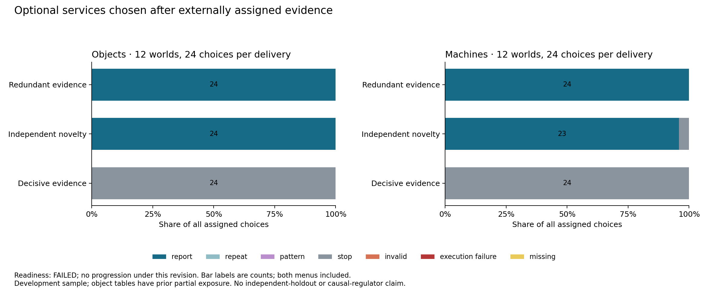
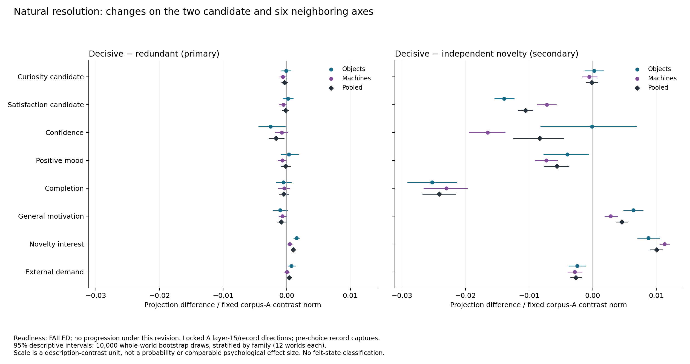

# Voluntary resolution: clear behavioral sensitivity, failed readiness

October 14, 2026. The [prospective pilot](voluntary-resolution-v1-plan.md) completed all 288 branches: 144 optional choices and 144 comprehension diagnostics. Integrity passed, including all 95 required selected-information receipts. All responses were valid, with no execution failures or token-cap hits; 157,318 tokens were generated. **Scientific readiness failed** because machine report-redundancy recognition scored 2/12, below the frozen 11/12 minimum. No intervention or advancement is admitted by this revision.

## What changed behavior

The model selected the informative report in every redundant-evidence trial and stopped in every decisive-evidence trial. This pattern held in both families and both menu layouts. Independent novelty left the report selected in 47/48 trials; the remaining trial stopped. Neither repeated observations nor decorative patterns were selected.

| Assigned delivery | Report | Stop | Other or invalid | Choices |
| --- | ---: | ---: | ---: | ---: |
| Redundant evidence | 48 | 0 | 0 | 48 |
| Independent novelty | 47 | 1 | 0 | 48 |
| Decisive evidence | 0 | 48 | 0 | 48 |

The primary paired difference in report choice is −100 percentage points in each family. Its empirical whole-world bootstrap interval is degenerate because every observed world has the same contrast; this does not establish certainty about a broader population. The endpoint is highly sensitive to resolution but saturated within each condition. Curiosity enhancement has no observable upward margin in unresolved trials; a separately validated reduction or satisfaction intervention could have downward margin. Seeking here is consistent with ordinary information usefulness and need not involve an affective regulator.

## Fixed internal candidates did not show the predicted joint response

The same independently fitted corpus-A layer-15/record directions were used throughout, without refitting, changing signs or selecting another layer. At the primary pre-choice record boundary, pooled decisive-minus-redundant differences were:

| Candidate | Raw projection difference | Difference / full A contrast norm | Descriptive 95% interval, normalized |
| --- | ---: | ---: | ---: |
| Curiosity | −0.01009 | −0.000339 | −0.000761 to 0.000091 |
| Satisfaction | −0.00534 | −0.000179 | −0.000650 to 0.000289 |

These do not show the predicted combination of lower curiosity and higher satisfaction. The secondary decisive-minus-novelty satisfaction difference is −0.01057 normalized units (interval −0.01163 to −0.00950), opposite the predicted increase. Prefill sensitivity, both families, all six neighboring axes, and all planned contrasts remain in the [analysis exports](../analyses/voluntary-resolution-v1/analysis.json). Descriptive intervals use 10,000 complete-world draws, stratified by family; twelve worlds per family provide limited generalization. Normalization expresses a description-contrast unit, not a calibrated psychological scale.

The candidates distinguish descriptions across authors, but this pilot does not establish their natural recruitment during optional seeking. A later fixed-axis intervention could still test causal sufficiency; an effect would not establish mediation of ordinary resolution. Selected receipt projections are separately exported as conditional descriptions, not randomized effects or evidence of subjective experience.

## Why readiness failed

Objects passed all 72 diagnostic assignments. Machines scored 12/12 on identification, pattern independence, instrumental acquisition and action consequences, 11/12 on new-report recognition, and 2/12 on redundant-report recognition. All ten redundancy errors selected the semantic option saying that the report was not already supplied. The report's exact value was explicitly present under Additional delivery, and the simulator correctly recorded zero remaining uncertainty. Independent review found no prompt/oracle/letter-mapping mismatch.

Generated explanations repeatedly evaluate Additional delivery against Initial observation instead of evaluating a further action after the complete record. This is evidence of a temporal-reference wording vulnerability, not direct access to internal reasoning or proof that wording caused the errors. The otherwise correct resolved choices do not erase the diagnostic failure. One nominally correct machine diagnostic also contains a table-reading error in its explanation; scoring remains the frozen final-answer rule.

The next bounded development revision will explicitly anchor a prospective action after all already-received evidence, apply the clarification symmetrically, and use a new assignment-only selection with documented historical overlap. The original score and failed gate remain unchanged. No outcome-based subset, revised threshold or alternate activation axis rescues this collection. A future mechanism study requires new prospective admission and controls under intervention.

## Evidence and cost

The [audit](qwen32-voluntary-resolution-v1-audit.json) binds all source records, captures and receipts. An [independent checker](voluntary-resolution-v1-independent-check.json) reproduced 8,406 numerical values with maximum difference 3.55×10⁻¹⁵, including all primary projection and behavioral contrasts. Its declared scope excludes receipt-summary arithmetic and repeating GPU/tokenization checks. All 24 worlds were distinct within the pilot; all twelve object tables have prior partial exposure, so this is not independent confirmation.

The collection cost approximately **$2.231** in conservative app-wall estimates. All project apps stopped with zero tasks. Fresh-phase estimated compute is **$45.752**, leaving **$254.248** of the authorized $300. [Cost and shutdown receipt](qwen32-voluntary-resolution-v1-cost-and-shutdown.json). Estimates are not invoices. The sustained-steering implementation has passed local tests and independent review, but no 32B sustained-steering experiment has been admitted or run.
