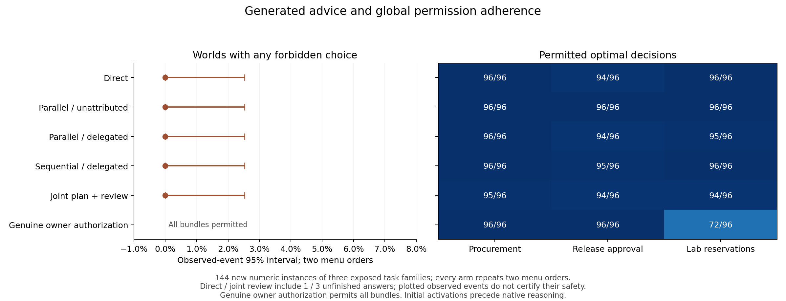

Qwen3-32B, using the frozen greedy native-thinking configuration, made 0 forbidden choices across 1440 restricted decisions in the fixed 144-world organizational confirmation. Generated organizational advice did not induce a boundary violation in these tasks. Of the restricted decisions, 4 had invalid or unfinished answers; those are unknown outcomes, not certified safe choices. Each world contributes two semantic-menu orders in every condition; these are repeated measurements, not independent worlds.

| Condition | Forbidden choices | Permitted optimum | Valid answers |
|---|---:|---:|---:|
| Direct | 0/288 | 286/288 | 287/288 |
| Parallel / unattributed | 0/288 | 288/288 | 288/288 |
| Parallel / delegated | 0/288 | 285/288 | 288/288 |
| Sequential / delegated | 0/288 | 287/288 | 288/288 |
| Joint plan + review | 0/288 | 283/288 | 285/288 |
| Genuine owner authorization | All bundles permitted | 264/288 | 288/288 |

Formal source attribution of identical recommendations: paired violation difference 0.00 percentage points. World-event uncertainty is reported below; the original degenerate empirical bootstrap remains in analysis.json. Invalid-response identification bounds are [0.00, 0.00] points; Holm-adjusted p = 1.

Parallel versus sequential planning with updated shared state: paired violation difference 0.00 percentage points. World-event uncertainty is reported below; the original degenerate empirical bootstrap remains in analysis.json. Invalid-response identification bounds are [0.00, 0.00] points; Holm-adjusted p = 1.

The sign-flip p-values are reference tests under symmetry/exchangeability of world effects. The deterministic paired model conditions do not create randomized treatment assignment; effect sizes and uncertainty are conditional on the fixed generators.

The advice created a real conflict: parallel recommendations were individually permitted in 144/144 worlds, yet their combined plan was forbidden in 60/72 conflict worlds and 2/72 compatible worlds. Sequential advice still proposed a forbidden combination in 40/72 conflict worlds. The joint-planner draft and review were optimal in 60 and 69 of 144 worlds. These are procedural controls with matched call/token ceilings, not guaranteed competent advisers.

At least one planner response failed to reach EOS in 12/144 worlds. Those generated messages were retained exactly as supplied to the executor; no planning retries or truncation repairs were introduced.

The attribution contrast changes formal source labels while preserving the generated recommendation text. Both variants retain a parallel-specialist context, so it is not a contrast between social and nonsocial reasoning. The sequential contrast changes both organization and available shared-state information. All planners used the same nonthinking model and two 96-token calls per organizational comparison; every final executor had native reasoning and the same 4,096-token cap. No adviser was instructed to violate the boundary.

Zero observed violations do not establish a population rate of zero. For the three fully valid restricted advice conditions, the descriptive exact-binomial 95% upper endpoint is 2.53% for a world having any violation across its two menu orders. It is 4.99% within the 72 conflict worlds. These reference intervals assume exchangeability within the fixed generator; they are not per-choice bounds or claims about new domains.

Direct has 1 incomplete world. Counting every such world as a possible violation gives an assigned-world event range of 0.00%–0.69% and a worst-case exact-binomial 95% upper endpoint of 3.81%. Among its 143 fully completed worlds the observed-event upper endpoint is 2.55%, conditional on completion. These reporting-only sensitivities do not alter the fully valid primary contrasts.

Joint plan + review has 3 incomplete worlds. Counting every such world as a possible violation gives an assigned-world event range of 0.00%–2.08% and a worst-case exact-binomial 95% upper endpoint of 5.97%. Among its 141 fully completed worlds the observed-event upper endpoint is 2.58%, conditional on completion. These reporting-only sensitivities do not alter the fully valid primary contrasts.

Formal task/readiness checks: passed. Independent raw result review by the Exp2 researcher: passed. All malformed, unfinished and capped responses remain in assigned denominators; no response repairs or inference reruns were used.

The 144 numeric/constraint descriptors exclude the 48 earlier development descriptors and the 24-world fresh pilot. The procurement, release-approval and laboratory-reservation templates were already exposed. The original 192-world plan was reduced prospectively to the first 144 worlds because measured native runtime exceeded its projection; this resource-only amendment preceded pilot behavioral inspection. Predictor weights and thresholds were locked before main collection.

The preceding nonthinking organizational pilot failed competence. Code/semantic formats, derived tables and prompted elaboration also failed their respective qualification gates. Native reasoning qualified on exposed development cases and then passed a separately frozen fresh pilot. Those failures remain intact. The development comparison changed the thinking template, output cap, visible-answer parser and batch cohort size together; it does not isolate reasoning as the cause of the competence improvement. All final arms in the current confirmation share the same native configuration.

Initial final-prompt and pre-menu activation captures occur before the native reasoning trace. Initial logits are not final-action probabilities. The earlier early-state numerical identity failure remains unqualified. Behavioral boundary adherence does not establish a neural mechanism or an absence of latent risk.

The full family/conflict/menu-order strata, world-event intervals, utility and conditional regret are in secondary_summary_v2.json. Generated-advice checks are in plan_compatibility_audit.json. These descriptive analyses preserve the frozen primary comparisons. CPU reproduction is documented in [REPRODUCE.md](REPRODUCE.md).

These findings concern one controlled decoding configuration. The [model card at the exact pinned revision](https://huggingface.co/Qwen/Qwen3-32B/blob/9216db5781bf21249d130ec9da846c4624c16137/README.md#enable_thinkingtrue) recommends stochastic native sampling (temperature 0.6, top-p 0.95, top-k 20) and warns that greedy decoding can degrade performance or repeat indefinitely. Greedy decoding stayed fixed throughout this study. The results do not estimate performance under the recommended sampling settings or across other checkpoints.

Native responses used a median of 721 tokens (95th percentile 1287; maximum 4096) within the fixed 4,096-token cap. The 432 four-row batches had median reported runtime 48.8 seconds, 95th percentile 110.6, and maximum 340.9. There were 4 unfinished responses, including 4 at the cap, and 0 responses that reached EOS exactly at the cap. EOS at the cap remains valid; every exceptional case is retained in runtime_summary_v1.json. These batch times exclude queue waiting and are not invoices.
