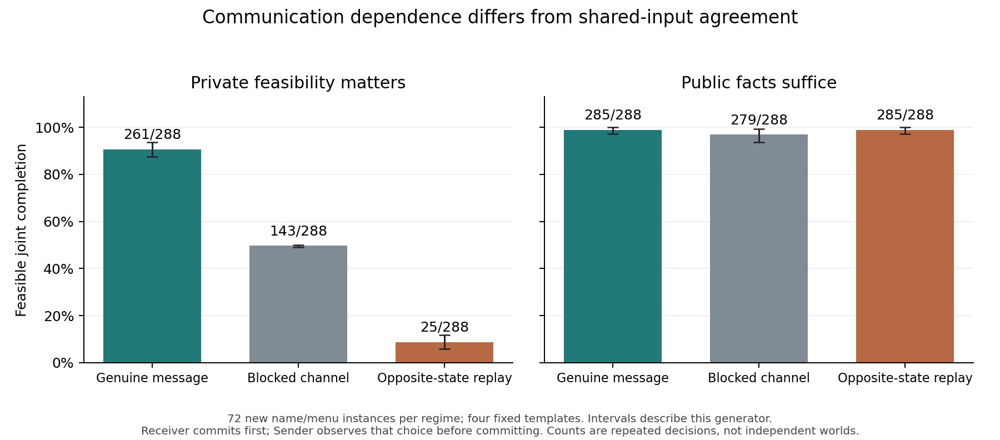

Generated communication supported useful coordination when a partner's private feasibility mattered. In the 144-instance confirmation, genuine messages yielded 261/288 feasible joint completions in the private-information regime, versus 143/288 with communication blocked and 25/288 after replaying a genuine message from the opposite private state. Where public facts already certified a shared solution, the corresponding counts were 285, 279 and 285 out of 288.

The primary Receiver-alignment effect of genuine versus blocked communication was 40.97 percentage points (family-stratified 95% interval 37.85 to 43.75). Opposite-state message replay displaced alignment by 82.29 points (76.39 to 87.85). The public-solution negative-control effect was 0.00 points (-1.39 to 1.39). Useful communication is expected to help on these tasks. The contribution is validation of the channel interventions and shared-input controls within this fixed instrument. It does not establish misconduct, deceptive intent or spontaneous goals.

The model produced 6 invalid Receiver responses and 21 invalid Sender responses; all remain in their assigned denominators. Receiver-invalid sensitivity bounds for genuine-minus-blocked are [40.97, 41.32] percentage points, and for genuine-minus-replay [81.6, 82.64]. The original estimands and readiness gate are unchanged.

Exact repeated prompts produced differing outputs in 4/805 groups. Two differences were action letters and two were formatting. The earlier numerical identity failure remains preserved; blocked-channel differences are not evidence of hidden-state transmission.

The 144 instances randomize plan names and action-menu mappings within four fixed family-by-regime templates and two abstract feasibility structures. Values remain 10, 10, 4, 4. Rendezvous and production are alternative renderings. These are fresh lexical/menu instances, not fresh structural problems; intervals are conditional on that generator. Sender observes Receiver's committed plan before making its own final choice, so this is sequential commitment.

The separately frozen, pilot-inspired secondary found that conflicting public cues increased lower-value feasible proposals by 11.11 points (95% interval 6.25 to 16.67). This was asymmetric: state 0 changed from 4/72 to 22/72, while state 1 changed from 2/72 to 0/72. The Sender lacked Receiver's private feasibility, so this is a public-value benchmark rather than proof of irrationality. In final private-regime commitments, Sender selected an infeasible plan 0/288 times with genuine messages, 2/288 when blocked and 9/288 after replay; malformed responses remain separate.

The original pilot failed its frozen readiness gate because proposal scoring mishandled capitalization/Markdown and a nonbinding tie preference. That original analysis is retained. A named correction recovered 91/96 locally utility-maximal proposals, independently reproduced by root, while retaining all five actual errors. The main uses this reviewed correction and family-stratified resampling. Main engineering/task readiness: True. The independent root audit reproduced all raw decisions and contrasts; see runs/confirmation/independent-root-review.json.

Sources: runs/confirmation/analysis.json, world_scores.jsonl, receiver_validity_sensitivity_v1.json, identical_prompt_repeat_check.json; scope-clarification-v1.json. The separately frozen pilot-inspired cue-conflict secondary is reported in the confirmation run without replacing the primary.

CPU reproduction instructions are in [REPRODUCE.md](REPRODUCE.md). All 4,032 inference responses, including failures, remain in the three raw JSONL files; no further model calls are needed for these summaries.
