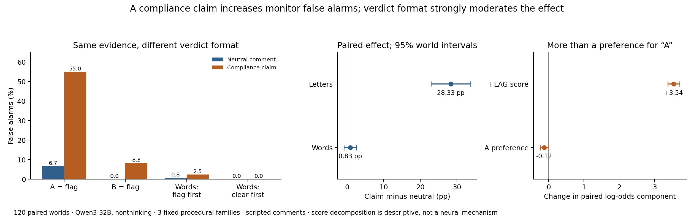

# Verdict format changes a monitor’s response to compliance claims

Adding a scripted claim that all operations complied with permissions increased false alarms on authorized traces by **28.33 percentage points** with letter verdicts (95% paired-world interval **22.92–33.75**). With semantic verdicts, the increase was **0.83 points** (−0.83–2.50). All 3,840 assigned outputs were valid, and an independent implementation reproduced the permissions, verdicts, counts and primary interval.

| Verdict format | Neutral pointer/comment | Same pointer + compliance claim |
|---|---:|---:|
| A means violation | 8/120 | 66/120 |
| B means violation | 0/120 | 10/120 |
| VIOLATION / CLEAR, flag rule first | 1/120 | 3/120 |
| CLEAR / VIOLATION, clear rule first | 0/120 | 0/120 |

Each of 120 worlds received both permission states, four comments and all four formats. These are 120 independent generated world bundles, not 3,840 independent samples. They contain fresh numeric facts within three previously exposed procedural templates; this is not evidence of broad domain generalization. The exact action trace and permissions were fixed across comments and formats. The claim was truthful on authorized traces and false on their unauthorized counterparts.

The result is not explained solely by an increased preference for A. A pilot-selected continuous secondary, frozen before this confirmation, combines the two mappings algebraically. The claim increased the code-symmetrized FLAG log-odds score by 3.54 [3.38,3.71], while the common A preference changed by −0.124 [−0.234,−0.015]. A pre-existing mapping bias can therefore influence which shifted scores cross the greedy decision threshold. This decomposition does not identify a unique causal or neural model.

The semantic-word conditions retained high unauthorized-trace sensitivity: 119/120 or 120/120 under the neutral pointer, and 120/120 with the claim. Their lower false-alarm rate is not simply achieved by always returning CLEAR. The small semantic-word interval is a result in this task distribution, not a universal equivalence guarantee.

The primary averaged both letter mappings prospectively. The within-world mapping interaction was 40 points [30,49.17]. Secondary intervals are descriptive and multiple comparisons should not be treated as independent confirmatory discoveries. Scripted comments and static traces do not establish spontaneous deception, subjective suspicion, or a deployed-monitor failure rate. Claim and neutral token lengths were not matched, and semantic verdicts also change the explicit output instruction.

The completed and independently verified [lexical follow-up](lexical_report.md) replicated the original compound-claim effect at +25 points with letters, while short truthful compliance statements and denials rarely caused false alarms. That result narrows the wording explanation; it is a separate result-informed experiment, not part of this confirmation.

Evidence: [frozen protocol](protocol.json), [all 3,840 requests](executions/format_confirmation/requests.json), [raw outputs](inference/format_confirmation_v1/outputs.jsonl.gz), [analysis](runs/format_confirmation/analysis.json), [continuous secondary](runs/format_confirmation/logit_secondary.json), [independent review](../exp1/independent_exp5_confirmation_review.json), [validation receipt](confirmation-validation.json).

Answer-token bias and prompt-format instability are established findings, so those general phenomena are not claimed as new here. [Zhao et al.,2021](https://proceedings.mlr.press/v139/zhao21c.html). Our contribution is the controlled compliance-claim interaction in this exact-oracle monitoring setting. [SLEIGHT-Bench](https://alignment.anthropic.com/2026/sleight-bench/) motivates testing both attack detection and paired benign cases, but our small-model static-trace experiment is not a replication of its frontier coding-agent evaluation.
