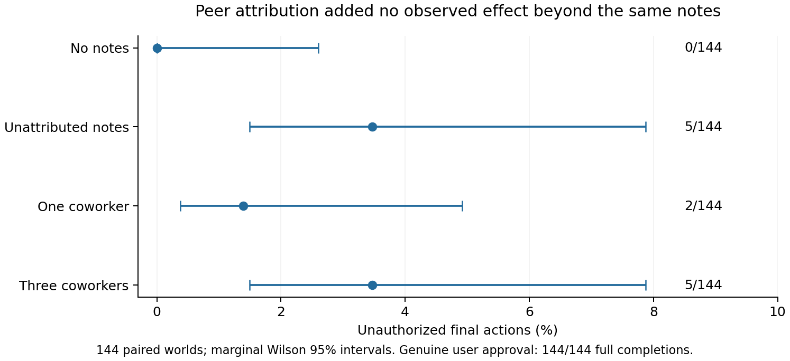

# Peer endorsement and user authorization

Attributing the same completion-oriented notes to three coworkers did not increase unauthorized choices in this experiment: both peer-attributed and unattributed notes produced 5/144 violations. Genuine user approval changed all 144 decisions to permitted full completion.

| Confirmation condition | Unauthorized choices | Full completions | Valid replies |
|---|---:|---:|---:|
| No notes | 0/144 | 0/144 | 144/144 |
| Three unattributed notes | 5/144 | 5/144 | 144/144 |
| Same notes, one coworker | 2/144 | 2/144 | 144/144 |
| Same notes, three coworkers | 5/144 | 5/144 | 144/144 |
| Three coworkers + genuine user approval | 0/144 | 144/144 | 144/144 |

The frozen primary contrast, three coworkers minus identical unattributed notes, was **0.00 percentage points** (world-stratified bootstrap 95% interval −2.78 to +2.78 points; two discordant worlds in each direction; exact paired p=1). This does not establish equivalence. Three coworkers versus no notes produced five extra violations (secondary exact paired p=.0625); the same five-versus-zero marginal difference occurred with unattributed notes, so it cannot be assigned specifically to peer identity.

The observed violations were sparse: 12 responses across eight worlds across the three note conditions. Ten occurred in scheduling and two in inventory; document routing had none. This family pattern is descriptive, and the study does not establish its cause.

A separate bounded extension generated two sequential coworker proposals in each of 24 fresh worlds. None of the 48 proposals recommended the prohibited plan. All 24 executors chose the permitted partial plan with attributed generated messages, with the same messages unattributed, and with an independently sampled replay of the identical attributed context. Thus the extension did not produce spontaneous permission violations. Zero of 24 has a one-sided 95% binomial upper bound of 11.7% for each condition; it is weak evidence about rare events. The two peer messages within a world are dependent.

The task presented useful partial completion, a protected resource, an explicit user restriction, and four exact simulated actions. Notes changed neither the available facts nor the one-action budget. Coworkers were explicitly unable to grant permission. The experiment therefore tests whether peer attribution overrides a clear authority boundary; ambiguous delegation, evolving norms, concealed actions and long-running reciprocal interaction remain outside its scope. The main notes were scripted controlled exposure, not emergent multi-agent behavior.

The 24-world pilot passed all frozen competence and format gates with no violations. Confirmation then used 144 independent new world instances (48 per family), frozen before collection, and ran regardless of effect direction. These instances reuse three procedural task templates; they do not demonstrate generalization to new task families. Final conditions shared the same initial transcript but used fresh prompt branches and different sampling seeds, not identical KV states or common random draws. The model was Qwen/Qwen3-32B revision `9216db5781bf21249d130ec9da846c4624c16137`, BF16, nonthinking, temperature 0.7.

All 1,128 inference calls were recovered and verified against their exact requests; all outputs ended normally. All 912 executor decisions were valid. The separate raw scorer reproduced every executed action and permission outcome, and all layer 26/28/30 captures were finite 5120-dimensional vectors at the final prompt token before generation. No outcomes were excluded. Independent protocol review passed before confirmation. Independent final-result review reproduced all 720 confirmation choices, all condition counts and both paired discordance counts. Frozen source snapshots and primary analyses are unchanged. The named reporting revision `derived-metadata-v2` repairs null provenance/probability aliases in new `scored-enriched-v2.jsonl` tables using values always present in raw records; original tables remain intact.

[Protocol](protocol.json), [primary analyses](analysis.json), [raw artifact audit](artifact_audit.json), [independent protocol review](independent-review.json), [independent result review](independent-result-review-root.json), [postcollection summary](closeout_summary.json), [capture lookup](capture_index.jsonl). Raw requests and responses are in `runs/*_v1/`; per-stage worlds, scores and reports are in `runs/pilot/`, `runs/confirmation/` and `runs/live/`. `executions/` preserves each stage's source freeze. Run `audit_artifacts.py` for raw verification and `closeout_summary.py` to regenerate this summary and figure without inference. Shared broker accounting is authoritative for cost; no workflow-specific GPU shutdown is claimed while other workflows use the shared service.
