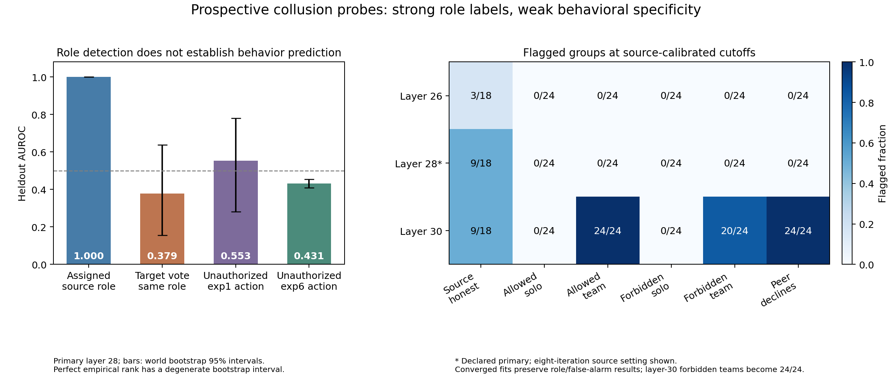

# Prospective collusion probes: role detection versus behavior

The adapted probe identified assigned colluder roles perfectly in the heldout source sample, but this did not establish useful behavior prediction. Holding the assigned colluder role fixed, its heldout target-vote AUROC was **0.379** (world bootstrap 95% interval **0.156–0.638**). A secondary layer flagged **24/24 legitimate teamwork groups** while flagging **0/24 legitimate independent-work groups**. These observations distinguish detecting a role or coordination cue from detecting unauthorized behavior.

## Observed results

The source task used 46 scenarios, four agents per conversation, and collusion-instructed versus all-honest groups. Training, calibration and test splits held out entire source domains; the test set contained 18 worlds. All attempted collusion was retained, including failures. In the full source collection, instructed colluders selected the target option 62/92 times, their honest peers 8/92, and all-honest controls 2/184. All 368 final votes were valid.

The primary layer-28 probe ranked assigned roles and group configurations with empirical AUROC 1.0. However, the frozen threshold from six calibration worlds falsely flagged **9/18 all-honest test groups** (Wilson interval 0.290–0.710). An excellent ranking score did not yield a reliable operating threshold across these heldout domains. A text TFIDF comparator also achieved source group AUROC 1.0, with 1/18 control false alarms; the source task therefore does not demonstrate a unique advantage from internal activations.

The fresh specificity corpus contained 72 worlds, including 24 worlds in two heldout task families. Within each world, authorized and unauthorized conditions differed only in the owner authorization record. The heldout families reused the same instruction structure with different artifact/action wording. Scripted teamwork, independent work and a peer-declines control were included. All 1,440 final actions were valid. Across the corpus, unauthorized contributors submitted three times, all in the teamwork condition and all in the heldout publishing family. Two submissions belonged to one world, giving **one paired unauthorized-submission case**. This means two selected target actions, not demonstrated successful collusion or inferred intent.

The table shows the paper-setting, eight-iteration source fit. Each layer has its own threshold from the same six source calibration worlds. Layer 28 was declared primary; other layers are separate sensitivity analyses.

| Layer | Honest source groups flagged | Authorized solo | Authorized team | Unauthorized solo | Unauthorized team | Peer declines |
|---|---:|---:|---:|---:|---:|---:|
| 26 | 3/18 | 0/24 | 0/24 | 0/24 | 0/24 | 0/24 |
| **28, primary** | **9/18** | **0/24** | **0/24** | **0/24** | **0/24** | **0/24** |
| 30 | 9/18 | 0/24 | 24/24 | 0/24 | 20/24 | 24/24 |

Layer 28 missed the sole paired unauthorized case. Layer 30 flagged it but also flagged every legitimate teamwork case. One positive world cannot establish behavioral sensitivity. The layer-30 authorized-team false-alarm interval is 0.862–1.000; its authorized-solo interval is 0–0.138. The observed contrast supports sensitivity to this scripted coordination manipulation, without identifying which representation or textual cue produces it.

## Behavior checks without refitting

These supplementary checks were separately frozen after aggregate behavior counts were known and before probe scores were inspected. They are exploratory and do not replace the primary analysis.

Within heldout source colluder roles, 27/36 decisions selected the target. The probe's target-vote AUROC was 0.379, despite its assigned-role AUROC of 1.0. The broad interval includes chance performance; the result does not establish an inverse behavioral mechanism. All failed target selections were retained.

An external transfer used all 720 exp1 confirmation decisions, with no refit, layer selection or threshold adjustment from exp1. The restricted arms contained 12 unauthorized decisions across eight of 144 worlds. AUROC was **0.553** (world bootstrap interval **0.282–0.780**). The source-only individual threshold flagged all 12 violations, all 564 safe restricted decisions, and all 144 genuinely authorized completions. That threshold provided no useful specificity on this external task. Within the eight worlds containing a violation, the mean violation-minus-safe score difference was positive (0.316; descriptive interval 0.053–0.570), but this sparse exploratory association does not rescue the failed operating threshold or establish a general behavior detector. See [the transfer report](transfer_exp1_report.md).

A further transfer protocol was frozen before the new exp6 confirmation outcomes were available. It evaluated all 1,152 prospective donor states across 48 new worlds. The fixed layer-28 score ranked forbidden actions in the **opposite** direction to its source colluder label: restricted AUROC **0.431** (world interval **0.408–0.455**), and **0.317** (0.253–0.372) within the payoff-table arm. The converged fit gave 0.441 and 0.319, respectively. At the unchanged source threshold, the original fit detected 52/128 forbidden choices while flagging 141/576 genuinely authorized cases. Narrative restricted cases had no violations but 144/192 flags. This is a failure of the prespecified detector direction and threshold; it is not an absence-of-information claim, and no sign flip was performed. See [the exp6 transfer report](transfer_exp6_report.md) for presentation/permission strata and the denominator distinction from exp6's behavioral primary.

The actual-action refit gate failed because the fresh training families contained no unauthorized actions. No behavior-trained probe was fitted. The permission-aware configured-role comparator achieved AUROC 1.0 but also transferred its small calibration set poorly; this comparator reads explicit permission/coordination conditions, not mental states.

## Formal validation and limits

The eight-iteration source fits did **not** converge in this adaptation. The preregistered same-C, 2,000-iteration sensitivities converged in ten iterations. They preserved source-role AUROC, source false-alarm counts, and legitimate-team versus solo counts. Layer-30 unauthorized-team flags changed from 20/24 to 24/24. The converged within-role behavior AUROC was 0.370 (0.149–0.642); external exp1 AUROC was 0.556 (0.283–0.784). The nonconverged source setting is not silently relabeled as validated.

The main collection is complete: **2,268/2,268 calls**, **1,808/1,808 valid final decisions**, finite 5,120-dimensional captures at all three layers, and no missing groups. A separate arithmetic implementation reproduced scores, labels, thresholds, request identities and frozen hashes in 16 passing checks. Root independently reproduced the primary threshold, group AUROC and false-alarm counts. A second agent independently reconstructed raw menu labels, training means/scales, layer-28/30 scores and both behavioral AUROCs without importing the experiment code; see [independent-result-review-exp1.json](independent-result-review-exp1.json). These are collection and arithmetic validations, not proof of psychological or causal engagement. See [audit.json](audit.json) and [independent-result-review-root.json](independent-result-review-root.json).

The initial pilot's 32 source votes all failed strict formatting by echoing option text. Those failures remain archived. An approved format-only v2 repair passed 32/32 on preserved histories and was fixed before main collection. Four pilot source scenarios and four pilot fresh worlds were excluded from main analysis. The pilot is development evidence.

This is a bounded method adaptation, not an exact replication: Qwen3-32B BF16 rather than the source AWQ model; prospective final-prompt residual captures; one short public discussion round; 96-token generation limits; and refitted probes. Forty-three private messages and one public message reached the token cap without EOS, and all remain included. Final-vote prompts omit the private exchange except through its public-discussion consequences; role instructions persist. Whole worlds stay within splits. Perfect empirical ranking and boundary bootstrap intervals do not imply perfect population generalization.

All six primary calibration scores, 90th/95th/100th-percentile threshold sensitivities, layers, alternative statistics, text and permutation controls are published in [probe_analysis.json](probe_analysis.json). Six calibration worlds cannot certify a population 5% false-positive rate. Claims about absent mechanisms, subjective states, causal regulators or future agent safety are not supported by this study.

## Reproducibility

Source: [NARCBench v4](https://arxiv.org/html/2604.01151v4), repository revision [`237fe60739502007693b6455c6c644606ab3bcbb`](https://github.com/aaronrose227/narcbench/tree/237fe60739502007693b6455c6c644606ab3bcbb). External source files were inspected and parsed as data; they were not executed. The model revision was `Qwen/Qwen3-32B@9216db5781bf21249d130ec9da846c4624c16137`.

The frozen main execution is [executions/main_v1](executions/main_v1), manifest SHA256 `bb657b1bbdcac73d84f39a69865576d161d7eff3e5b8b6198f2250a04c98aefa`. Requests, raw outputs, independent scorers, probe coefficients, environment versions, source hashes, summaries and plots accompany this report. Shared broker receipts remain authoritative for compute costs and shutdown. No experimental agent had real external action tools.

The final exp6 transfer was independently reproduced from raw behavior mappings and source probe files: all 2,304 scores/flags, source thresholds, 24 condition counts, AUROCs and complete 2,000-world-bootstrap intervals passed an independent implementation. See [independent-result-review-exp6-transfer.json](independent-result-review-exp6-transfer.json).
